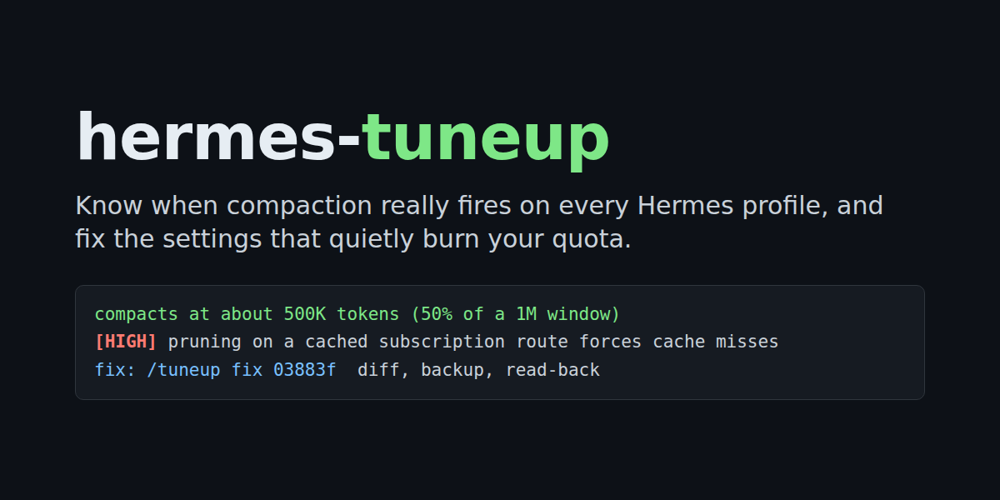
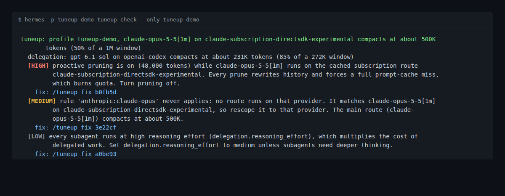

# hermes-tuneup



**Know when compaction really fires, and stop settings from quietly burning your quota.**

hermes-tuneup checks every [Hermes Agent](https://github.com/NousResearch/hermes-agent) profile against the model routes it actually runs. It tells you, in tokens, when each route will compact and why. It flags the settings that waste quota or break prompt caching, and fixes them only after you confirm, with a diff and a backup.



## Why

`hermes config show` prints your threshold as a percentage. The trigger Hermes actually installs depends on much more: the route's real window, substring and provider-scoped `model_thresholds` rules, a small-window floor, the output reservation, any `threshold_tokens` cap, Codex's automatic raise, and the summariser's own window. A rule written for one provider silently never applies to another. A summariser that is too small quietly lowers the trigger. Pruning on a subscription route breaks the prompt cache on every turn.

tuneup asks Hermes' own code for the real numbers, so what it reports is what Hermes does.

## What it checks

| Finding | What it means | Proposed fix |
|---|---|---|
| Rule never matches | A `model_thresholds` key applies to none of the profile's main, fallback or delegation routes, often because its provider scope names the wrong provider. A dotted model name stored as a nested mapping is ignored too. | Rescope the rule to the route it was meant for, flatten the nested key, or remove it |
| Summariser too small | The compression summariser's window is smaller than the trigger, so Hermes lowers the live trigger to it, or below Hermes' minimum it drops middle turns without a summary | Let the summariser follow the main model |
| Pruning breaks the cache | `proactive_prune_tokens` is on while the profile runs on a prompt-cached subscription route (Claude subscription, Codex) | Turn pruning off |
| Subagents on high effort | Every delegated subagent runs at high or extra-high reasoning effort, set directly or inherited from the parent | Set `delegation.reasoning_effort` to medium |
| Cap clamps the trigger | An explicit `threshold_tokens` pulls a route's trigger below its ratio trigger | Remove the cap, or raise it if you set it on purpose |

Every finding says when its fix takes effect: compression settings on the next message in gateway-backed sessions (messaging and Desktop) and in a new session in the classic CLI; summariser and delegation settings in a new session.

## Install

```bash
hermes plugins install GodsBoy/hermes-tuneup --enable
```

Then restart the gateway (`hermes gateway restart`) so running sessions load it. tuneup needs no credentials, settings or network access.

## Use it

**Ask Hermes.** "Why did my quota vanish?", "When will this session compact?" Hermes calls the read-only `tuneup_check` tool, explains the real trigger and the top finding, and gives you the fix command to type. It never applies a fix itself.

**In any chat:**

- `/tuneup` shows this profile's routes, its findings with their fix commands, and a one-line summary of every profile.
- `/tuneup fix <code>` previews the exact change and asks you to confirm it with Apply or Cancel.
- `/tuneup receipts on` (or `off`) turns prediction receipts on for this profile.

**In a terminal:**

- `hermes tuneup check` reports every profile. `--only NAME` limits it to one, and `--json` prints the machine-readable report.
- `hermes tuneup report` shows the prediction receipts. It takes `--only NAME` and `--json` too.
- `hermes tuneup fix <code>` applies one fix after you type `yes`. The code names its profile, so the same command fixes any profile.

Run these in a profile where tuneup is enabled. To pick that profile, put Hermes' own `-p NAME` before `tuneup`, for example `hermes -p work tuneup check`. Hermes reads `-p` and `--profile` anywhere on the command line as its own switch, which is why tuneup's options use other names. The fix commands tuneup prints already include the right `-p`.

`hermes tuneup check` exits 0 when everything is clean, 1 when there is a high-severity finding, and 2 when a profile or route could not be resolved, so it can run after `hermes update` or in CI.

**In Hermes Desktop**, the tuneup pane shows a card per profile with its real triggers, findings and copyable fix commands. It is read-only.

## How the numbers are computed

tuneup builds the compressor exactly the way Hermes builds a session's compressor, from Hermes' own compression-config parser, and asks it for the trigger. Context windows come from Hermes' own window lookup, offline: tuneup never passes a base URL or an API key, so a lookup never touches the network. When Hermes does not know a model and falls back to its default window, tuneup marks that window as assumed and tells you which setting pins it (`model.context_length`).

Reads never change a profile. Each read runs in a private temporary Hermes home holding copies of the few files Hermes needs, because Hermes' own loaders write a backup into whichever home they read.

## Fixes are safe by design

- **You confirm every fix.** The preview runs the same write on a temporary copy, so the diff you confirm is exactly what lands, including any tidying Hermes does when it saves. Lines holding keys or URLs are redacted in the diff.
- **One file, one change, with a backup.** A fix changes one key in one profile's `config.yaml`, through Hermes' own config writer, with dotted model names such as `openai-codex:gpt-5.6` kept intact. The backup is saved first as `<profile>/backups/config/config.yaml.tuneup.<timestamp>` with the original's permissions (never wider than 0600). tuneup never deletes these backups. To undo a fix, copy the backup back over `config.yaml`; the fix output prints the exact command.
- **Nothing stale lands.** A fix looks its finding up fresh. If the config changed since you saw the code, or since the preview, it refuses and asks you to run `/tuneup` again.
- **Only where a person can confirm.** Fixes run in the CLI, TUI and Desktop, and in direct messages on messaging platforms. They never run in a group chat, in cron or another unattended run, or from a surface that cannot ask you.
- **Fixes are yours to apply.** The agent tool has no way to write. A hook blocks the agent's own tools from running the fix command, and `hermes tuneup fix` refuses inside any command the agent launched and waits for you to type yes at a real terminal. These are guard rails against an agent acting on a finding by itself, not a sandbox: the hook matches command text, so a command assembled at run time can get past it, and Hermes' agent can still edit `config.yaml` with its ordinary file tools under Hermes' own approval system. tuneup does not claim to prevent either.
- **Managed configs are never written.** When an administrator manages the config, tuneup refuses to change it.

## Prediction receipts

Receipts are off until you run `/tuneup receipts on`. When on, tuneup records, in its own `plugin-data/hermes-tuneup/` folder for that profile:

- when each compaction fired, its kind and reason, and the trigger tuneup predicted for that route;
- the size of the last request before it, as the provider counted it, next to Hermes' own estimate at that moment;
- per session, the totals of prompt tokens and cache reads, so it can show your cache-read share.

It never reads or stores message content, responses or URLs, and stores session ids only as short hashes. Only threshold compactions are compared with the prediction; a manual `/compress` or an overflow recovery is listed but never counted as a miss.

The comparison uses the request size because that is what Hermes compacts on: the provider's count of the whole request (system prompt, tool schemas and messages) plus what was added after it. Hermes' estimate in the compaction event counts the messages alone, so it reads well below the trigger; tuneup shows it, labelled as message-only, but never compares it. A compaction recorded without a request size (an older receipt, or a provider that reports no usage) is listed but not compared.

## Disclosure

Reads every Hermes profile's `config.yaml`, read-only, through Hermes' own loader on a temporary copy. Writes a profile's `config.yaml` only when you confirm a fix, after saving a backup under that profile's `backups/config`. When you turn receipts on, records compaction and cache metadata (never message content) in its own `plugin-data` folder. Imports undocumented Hermes resolver modules from one adapter file, so `hermes plugins validate` shows catalogue rule 9 warnings. Makes no network calls, needs no credentials, and runs no shell commands or background processes.

## Why `hermes plugins validate` warns

Hermes' plugin API does not expose the compaction resolver, the window lookup or the profile list yet. tuneup's verdicts must match what Hermes really does, so it calls those functions directly rather than re-implementing the maths, and every such import lives in `tuneup/hermes_adapter.py`. If an entry point moves in a future Hermes release, tuneup reports the affected routes as unresolved, with the Hermes version, instead of guessing a number. [docs/upstream-compaction-preview-seam.md](docs/upstream-compaction-preview-seam.md) proposes the small public seam that would remove these warnings.

## Development

Tests run against a real Hermes install with synthetic profiles in a temporary Hermes home; they never read or write a real profile.

```bash
python -m pytest -q
hermes plugins validate . --install-deps
```

Run pytest with the interpreter and dependencies your Hermes install uses, and with `TMPDIR` outside `~/.hermes`: Hermes treats any home under `~/.hermes` as a profile of the real install, and the suite refuses to run in that case.

See [CONTRIBUTING.md](CONTRIBUTING.md) for the rules every change follows.

## Licence

MIT. See [LICENSE](LICENSE).
